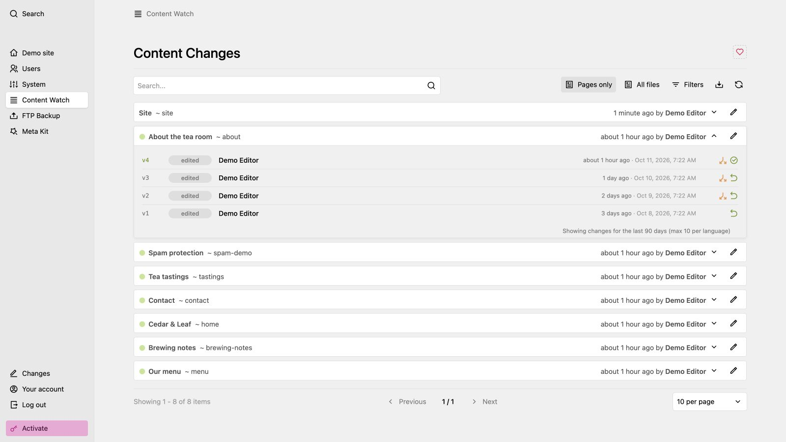
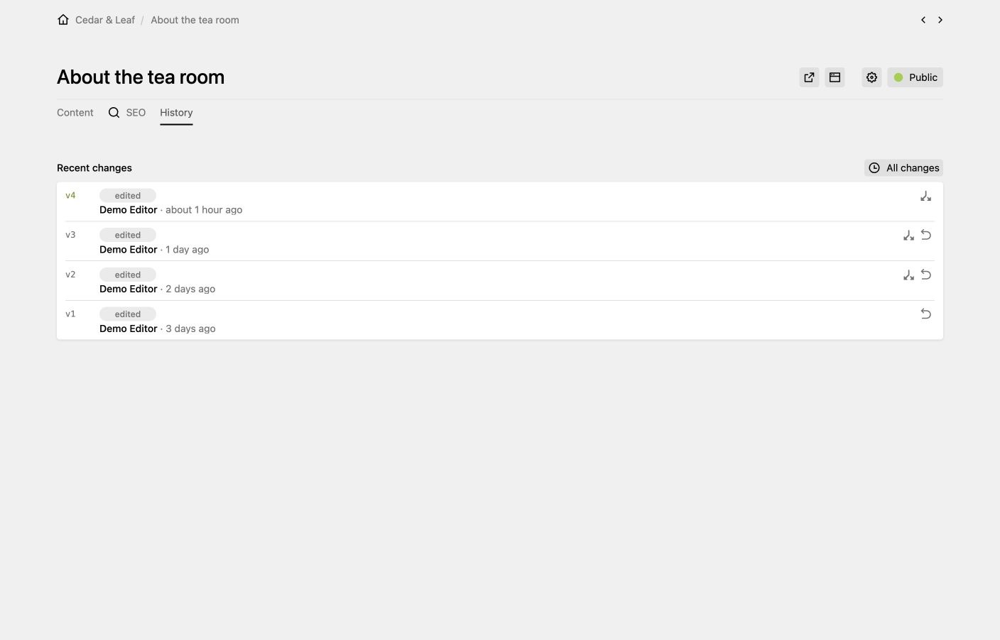

# Content Watch Plugin for Kirby

This plugin tracks all content changes in your Kirby site and adds a panel view that displays those changes.
It shows modification date and editor information and the history of changes for each file.
This allows you to keep track of what has been changed and who made the changes.

Additionally it provides a view to see which pages are currently locked and by whom.

[](https://github.com/tearoom1/kirby-content-watch)

***

## Features

- **Change Tracking**: Automatically tracks all content changes in pages and files
- **Editor Attribution**: Records which editor made each change with timestamp
- **History Timeline**: Lists all content files across your Kirby site, sorted by modification date
- **Locked Pages View**: Shows which pages are currently being edited and by whom
- **Search & Filters**: Find content by title or path and filter by author, status, template, period and language
- **Notifications**: Call a webhook or closure on every change, e.g. for Slack or mail
- **CSV Export**: Export the currently filtered change history as a CSV file for audits
- **Direct Panel Links**: One-click access to edit content in the Panel
- **Customizable Retention**: Configure how long history is kept
- **Version Restore**: Restore previous versions of content with a single click (optional)
- **Two Views**: Browse changes by page, or as a timeline of all changes grouped by day, where a deploy's changes outside the Panel collapse into one row
- **Dark Mode**: Supports Kirby 5 dark mode
- **History Section**: Show recent changes of a page, the site or a file directly in its blueprint, with diff and restore
- **Page Method**: Access change history programmatically via `$page->contentHistory()`

## Known Limitations

This plugin has been developed for rather smaller websites. It has not been tested on big sites or slow servers.
It stores all history entries in a single file for each content directory, and goes through them each time you open the plugins page.
This may be a problem for sites with a large number of files.

The restore feature also has some limitations
- binary files are not supported
- when restoring a page, its files are not restored
- only pages and the site can be restored; directories without a Kirby model (e.g. `_drafts`) are rejected
- a page is not moved back to a former parent page
- in Kirby 5, a page with unsaved changes in the Panel cannot be restored until the changes are saved or discarded
- a version that fails the current blueprint validation (e.g. an empty required field) cannot be restored as a published page

Restore runs through Kirby's own page actions as the current user, so the user's permissions, blueprint validation, hooks and the page cache all apply. Each restore adds a new entry to the history, so it can be undone. As with any tool that changes content, keep regular backups.

## Installation

### Manual

1. Download or clone this repository
2. Place the folder `kirby-content-watch` in `/site/plugins/`

### Composer

```bash
composer require tearoom1/kirby-content-watch
```

## Usage

After installation, you'll see a new "Content Watch" item in the Panel menu. Click on it to access:

- **By page**: All content files with their modification history
- **Timeline**: All changes across pages, the site and files, newest first and grouped by day (Today, Yesterday, then dates). Changes outside the Panel within five minutes of each other, typically a deploy, collapse into one row such as "Outside the Panel · 12 pages". Search and filters apply to both views. The timeline is paginated in the browser with the chosen page size.
- **Locked Pages**: Overview of currently locked pages and who is editing them

Each file in the list can be expanded to show its modification history. For each history entry with a snapshot, a restore button is available to revert to that previous version.

Changes that were not made in the Panel, e.g. by a deploy, FTP, git or a script, have no Panel user. They are shown as **Outside the Panel**; hover the name for an explanation. Changes by users that were deleted since are shown as **Deleted user**.

## Configuration

You can configure the plugin in your `config.php`:

```php
return [
    'tearoom1.kirby-content-watch' => [
        'allowedRoles'     => [],
        'retentionDays'    => 30,
        'retentionCount'   => 10,
        'defaultPageSize'  => 20,
        'defaultView'      => 'page',
        'enableLockedPages' => null,
        'enableRestore'    => false,
        'enableDiff'       => true,
        'notify'           => null,
        'disable'          => false,
    ]
];
```

| Option | Type | Default | Description |
|--------|------|---------|-------------|
| `allowedRoles` | array | `[]` | Additional Kirby roles allowed to use the plugin. Admins always have access (see Access Control) |
| `retentionDays` | `int` | `30` | Number of days to keep history entries before they are pruned |
| `retentionCount` | `int` | `10` | Maximum number of history entries to keep per file and language |
| `defaultPageSize` | `int` | `20` | Default number of items per page in the panel view. Possible values: `10`, `20`, `50` |
| `defaultView` | `string` | `'page'` | View the area opens with: `'page'` (changes grouped by page) or `'timeline'` (all changes, newest first). Editors can switch with the toggle next to the support link; their choice is remembered per user in the browser and wins over this option |
| `layoutStyle` | `string` | `'compact'` | **Deprecated.** The list always uses the compact layout; `'relaxed'` and `'default'` are still accepted but have no effect |
| `enableLockedPages` | `bool\|null` | `null` | Whether to show the locked pages view. `null` shows it on Kirby 4 only, since Kirby 5 has its own "Changes" overview |
| `enableRestore` | `bool` | `false` | Enable content restore functionality. When enabled, full content snapshots are saved — increases disk usage |
| `enableDiff` | `bool` | `true` | Enable content diff view. Requires `enableRestore` to be `true` |
| `notify` | `string\|Closure\|null` | `null` | Webhook URL (JSON `POST`) or closure called after every tracked change. See Notifications |
| `disable` | `bool` | `false` | Completely disable the plugin without uninstalling it |

### Notifications

Get notified whenever content changes, e.g. in Slack, Matrix or by mail. Set `notify` to a webhook URL to receive a JSON `POST`, or to a closure to handle the payload yourself:

```php
'tearoom1.kirby-content-watch' => [
    // Webhook
    'notify' => 'https://hooks.example.com/content-watch',

    // or a closure, e.g. to send a mail
    'notify' => function (array $change) {
        kirby()->email([
            'from'    => 'cms@example.com',
            'to'      => 'editor-in-chief@example.com',
            'subject' => $change['title'] . ' was ' . $change['action'] . ' by ' . $change['editor']['name'],
            'body'    => $change['panel_url'],
        ]);
    },
],
```

The payload contains `event`, `type` (`page`/`file`), `action` (`edited`, `moved`, `duplicated`), `id`, `title`, `version`, `language`, `time`, `editor` (`id`, `name`, `email`) and `panel_url`. Content snapshots are never sent. Webhook requests time out after 3 seconds, and failing notifications never block saving.

### Access Control

By default, **only users with the `admin` role** can access the plugin — that includes the Content Watch panel area, the menu entry, the diff API, and the restore API. Non-admins will not see the menu item, and any direct API call returns `403 Forbidden`.

To grant access to additional Kirby roles, list them in `allowedRoles`:

```php
'tearoom1.kirby-content-watch' => [
    'allowedRoles' => ['editor'],
]
```

Notes:
- Admins are **always** allowed; you do not need to include `'admin'` in the list.
- The `allowedRoles` check gates *access to the plugin*. A restore runs through Kirby as the current user and needs the same permissions as the change in the Panel: `update`, and `changeSlug`, `changeStatus` or `changeTemplate` when the restored version differs in these. A role allowed by `allowedRoles` cannot use restore to change anything it is not normally allowed to change.
- Restore and diff API requests are authenticated and only resolve history files inside Kirby's configured content root.
- Only grant `allowedRoles` to roles you trust to read every page's modification history, including drafts.

## How It Works

The plugin creates a `.content-watch.json` file in each content directory that has been modified. This file stores the history of changes including editor information, timestamps, and content snapshots for restoration (if restore is enabled).
History entries are automatically pruned based on your retention settings.

When restore functionality is enabled:
1. Each time content is changed, a snapshot of the content is saved
2. You can view and restore previous versions through the interface
3. When you restore a previous version, the plugin runs Kirby's own actions as the current user: `changeTemplate`, `changeSlug` and `changeStatus` when the version differs, then `update` with the content of the version. Permissions, blueprint validation, hooks and the pages cache apply as for any change in the Panel. Everything that can be checked upfront (permissions, a URL appendix used by another page, unsaved changes) is checked before anything changes; if a Kirby action still fails, the steps done so far are undone.
4. Restoring a translation only restores the content and the translated URL appendix of that language. Template, folder name and status follow the default language. The fields are written exactly as the version stored them: a translation only gets the fields its own file had, so values shown from the default language (fallbacks) and untranslatable fields are never copied into it, and blocks keep their stored formatting.
5. The restore is added to the history as a new version that refers to the restored one. Older versions stay as they are, so you can go back.

Changes are recorded in the language that was written, also when code updates a translation (e.g. `$page->update($data, 'de')` from a translation plugin while the request runs in English); one update that writes several languages adds one entry per language.

The history file is changed under a lock and replaced atomically, so parallel saves keep all entries. A history file that can't be read is moved aside as `.content-watch.corrupt-<time>.json` and a new history starts, saving content never fails because of it.

When restore functionality is disabled:
1. The plugin only tracks metadata like timestamps and editor information
2. No content snapshots are stored, reducing disk usage
3. The restore buttons will not be displayed in the interface

> NOTE: The restore functionality only works for page content.
> It does not track changes of media/binary files.
> And when restoring a page, it does not restore its files.


### History Section

Show the recent changes of a page, the site or a file right where editors work by adding the `contentwatch` section to its blueprint:



```yaml
sections:
  history:
    type: contentwatch
    headline: Recent changes # optional
    limit: 5                 # optional, number of entries
```

The section lists version, editor, time and language of each change and links to the full history in the Content Watch area. With `enableRestore` (and `enableDiff`) turned on, each change can be compared with the version before it and older versions can be restored right from the section. It is only visible to users who may access the plugin (see Access Control).

### Page Method

The plugin exposes a `contentHistory()` method on all pages, giving you programmatic access to the change history from within templates or plugins.

```php
// Get all history entries for the current page
$history = $page->contentHistory();

// Filter by language (multilang setups)
$history = $page->contentHistory('en');
```

Each entry is an array with the following keys:

| Key | Description |
|-----|-------------|
| `version` | Incrementing version number |
| `time` | Unix timestamp of the change |
| `editor_id` | ID of the Kirby user who made the change |
| `type` | Always `page` for page content |
| `language` | Language code (multilang only, requires `enableRestore`) |
| `content` | Raw content snapshot (only present when `enableRestore` is `true`) |

**Example: display last editor info**

```php
$history = $page->contentHistory();
if (!empty($history)) {
    $latest = $history[0];
    $editor = kirby()->user($latest['editor_id']);
    echo 'Last edited ' . date('Y-m-d H:i', $latest['time']);
    echo ' by ' . ($editor ? $editor->name() : $latest['editor_id']);
}
```

**Example: access field values from a snapshot (requires `enableRestore: true`)**

```php
foreach ($page->contentHistory() as $entry) {
    $fields = isset($entry['content'])
        ? new \Kirby\Cms\Content(\Kirby\Data\Txt::decode($entry['content']), $page)
        : null;

    echo 'v' . $entry['version'] . ' — ' . date('Y-m-d H:i', $entry['time']);

    if ($fields) {
        echo ' — title: ' . $fields->title()->html();
    }
}
```

This gives you full Kirby field method access (`.html()`, `.kirbytext()`, `.value()`, etc.) on any historical snapshot.

### Comparing Versions

With `enableRestore` and `enableDiff` turned on, each history entry has a "View changes" button. The dialog compares the chosen version with the current content by default; pick another version under "Compare with" to compare two versions.

- Only changed fields are shown, with the field label from the blueprint and the raw key next to it. A summary line tells how many fields changed and how many unchanged fields are hidden.
- Inside changed lines only the changed words are marked. Long texts show the changed lines with one line of context.
- Blocks and layouts are compared block by block (matched by their id): each changed, added, removed or moved block shows its type and position, changed blocks list their changed properties. Unchanged blocks collapse to one line. Structure fields are compared entry by entry.
- Files, pages and users show their names instead of their ids.
- Older versions that equal the current content show a grey diff button ("Same as the current version – no differences") and no restore button.
- Users who may update the page can restore the compared version right from the dialog ("Restore this version", with a confirmation). Only the language of that version is affected; files and other languages stay unchanged.

The optional `jfcherng/php-diff` package is no longer used by the Panel.

## Requirements

- Kirby 4 or 5
- PHP 8.1+

## Todo

- Add support for restoring media/binary files ?
- Language support is not perfect yet. Currently only 2 digit codes work and the display of the versions may also be improved.

## Support

Content Watch is free and MIT licensed, and it stays that way. If it saves you time, you can help keep it maintained. Paying is voluntary and any amount is welcome.

Agencies and companies that need an invoice can get a Supporter License. You choose the price and whether it covers one project or your whole company. Lemon Squeezy handles the sale as merchant of record, so you get a proper invoice with VAT. The license adds no features and no priority support.

[Support this plugin](https://www.tearoom.one/en/kirby-plugins/support)

## License

This plugin is licensed under the [MIT License](LICENSE)

## Credits

- Developed by Mathis Koblin
- Assisted by Claude (Anthropic)

## Screenshots

Screenshots use sample content at 1408 × 902 pixels. Panel views are cropped to the content area. The main image uses the light theme.

| View | Light | Dark |
| --- | --- | --- |
| Overview | [Light](screenshot.jpg) | [Dark](screenshot-dark.jpg) |
| Page history section | [Light](screenshot-section.jpg) | [Dark](screenshot-section-dark.jpg) |
